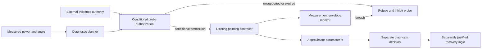

# Supervisory role, trust boundary and industrial positioning

The implemented `supervisor.py` is an authorization interface and a shadow monitor. It is not a hardware controller, an independent calibration authority, or a source of guaranteed diagnostic labels. It has been exercised on complete simulated probe records and synthetic refusal fixtures, not installed on an industrial optical terminal.

## Information required

A request includes the candidate's lower-power sequence, sample step/duration, current measured power and receiver threshold. Evidence includes finite actual-model identification, sensor scale/tail/horizon, optical bounds, a constant-offset window contract, gain-slope window contract, zero-reference history and bound-implementation provenance. Units must be radians and watts. Required evidence must cover the complete proposed window. Actual parameters between declared model points do not receive interpolated permission.

The code validates the presence, numeric consistency and expiry of supplied metadata. It does not inspect or certify a referenced calibration document. A real system needs an authorized calibration/model-management process to establish those facts. In particular, a future offset jump cannot be ruled out from one measured-power history. The monitor can detect inconsistent observations; it cannot retroactively prevent that first violation.

## Refusal and fallback

Missing evidence, stale/invalid expiry, unit mismatch, nonmember actuator models, inadequate event horizon, invalid budget/power or uninformative multiplicative intervals cause refusal. A low point measurement never by itself unlocks acquisition; the upper interval must be below sensitivity. Evidence explicitly marked simulation-only cannot authorize physical deployment.

During execution the monitor compares the measured-power **upper envelope** with the predicted true-power lower bound. This avoids treating ordinary measurement uncertainty as an immediate true-power breach. A contradiction marks the contract/model unsupported, inhibits repeat probing and requests an independently validated neutral-controller fallback. This is a request to existing fault-management logic, not a proof of immediate recovery or safe fallback transients.

Probe permission never grants arbitrary recovery authority. Estimation uncertainty is approximate, fit acceptance is a separate decision and actual link availability is an observed outcome. The API always reports `recovery_authorized=False`. An industrial implementation would require its own correction/fallback safety case, timing budget, model calibration, evidence integrity and hardware qualification.

## Executed evidence

Fourteen supervisory requirements plus three interval regressions pass. Shadow replay checks1,421 conditional requests and204,624 monitored samples on declared simulation contracts, with no observed envelope breach. These are not physical calibration approvals or embedded worst-case timing measurements. Synthetic test references are labelled `synthetic-fixture-only`; simulation replay uses `declared-simulation-contract`. No human/hardware evidence was invented.

## Journal positioning

The [IEEE IES publications description](https://www.ieee-ies.org/pubs) places TII in informatics bridging theory and industrial application, including intelligent/distributed control, embedded systems and industrial communications. That supports explaining an information-management/supervisory role, but does not establish that this simulated terminal study has demonstrated an industrial contribution.

The direct [TII author page](https://www.ieee-ies.org/pubs/transactions-on-industrial-informatics) returned a418 access response during this revision. Older indexed author PDFs were not treated as evidence of current page limits or submission rules. The six-page draft uses IEEE two-column styling; current TII compliance and scope suitability require final human verification. TAES/control-methods positioning remains plausible subject to novelty and evidence, not a promised fallback acceptance.
